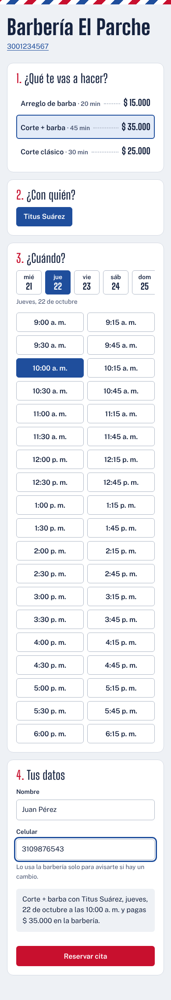
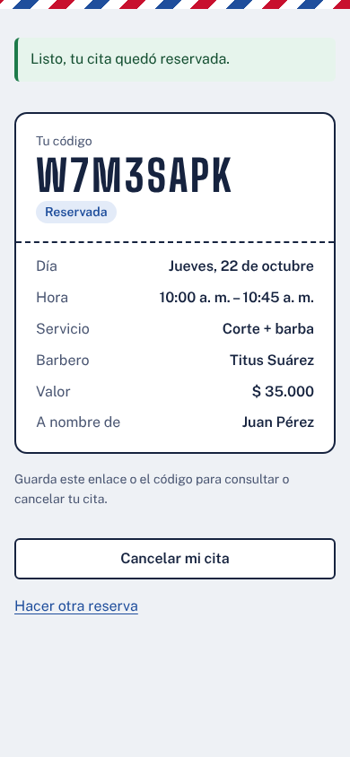
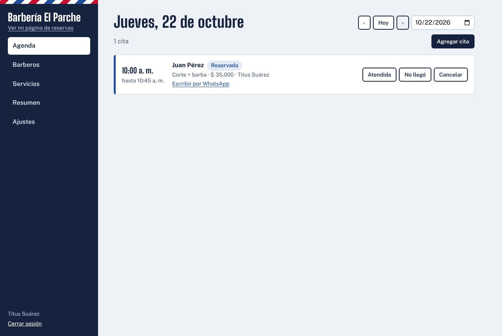

# BarberHub — SaaS multitenant de reservas para barberías

Cada barbería se registra y obtiene su propia página de reservas (`/el-parche`). Sus clientes eligen servicio, barbero y hora desde el celular; el dueño ve la agenda del día, marca citas atendidas y consulta cuánto facturó. Varias barberías comparten la misma instalación sin ver nunca los datos de las demás.

<p align="center">
  
  &nbsp;
  
</p>

<p align="center">
  
</p>

## Funcionalidades

**Para el cliente (sin crear cuenta)**
- Página pública por barbería con lista de precios, barberos y horarios libres reales.
- Reserva en cuatro pasos y comprobante con código para consultar o cancelar.

**Para el dueño**
- Registro en un minuto: queda con servicios y horario de ejemplo para empezar a recibir reservas.
- Agenda por día, filtro por barbero, citas de mostrador y estados (atendida, no llegó, cancelada).
- Botón para escribir al cliente por WhatsApp.
- Servicios con precio y duración, barberos con horario semanal propio.
- Resumen de ingresos por servicio y por barbero.

**Para los barberos**
- Cuenta propia que solo ve y gestiona su agenda.

**Para la plataforma**
- Superadministrador que lista barberías y puede desactivarlas.

## Stack

| Capa | Tecnología |
|---|---|
| Backend | Java 21, Spring Boot 3.5, Spring Security + JWT, Spring Data JPA / Hibernate 6, Flyway |
| Base de datos | PostgreSQL 16 |
| Frontend | Angular 21 (standalone, signals, zoneless), TypeScript |
| Infra | Docker, docker compose, Nginx, GitHub Actions |
| Pruebas | JUnit 5, MockMvc, PostgreSQL real embebido (zonky) |

## Cómo está resuelto el multitenancy

Modelo **una base de datos, un esquema, columna `tenant_id`** en cada tabla de negocio.

1. **Resolución del tenant por petición** (`TenantResolutionFilter`):
   - Rutas públicas `/api/public/{slug}/...` → el tenant sale del slug de la URL.
   - Rutas del panel → el tenant sale del claim `tid` del JWT firmado, nunca de un parámetro que mande el cliente.
2. **Filtrado automático con `@TenantId` de Hibernate 6**: cada entidad tiene su campo `tenantId` anotado. Hibernate agrega `tenant_id = ?` a todas las consultas (incluido `findById`) y lo asigna solo al insertar. Ningún repositorio filtra a mano, así que no hay forma de olvidarlo.
3. **Falla cerrado**: si una petición no tiene tenant, el contexto queda en `NONE` y Hibernate no devuelve filas de nadie. El superadmin usa un tenant `ROOT` explícito.

## Cómo se evitan las citas dobles

- **Bloqueo pesimista por barbero** (`SELECT ... FOR UPDATE`) al reservar: dos clientes que piden al mismo barbero a la vez se atienden en fila, y el segundo ya ve la cita del primero.
- **Restricción `EXCLUDE USING gist` en PostgreSQL** como red de seguridad: la base de datos rechaza dos citas activas del mismo barbero que se crucen, aunque un error en el código lo permitiera.
- Hay una prueba que lanza 8 reservas simultáneas al mismo turno y verifica que exactamente una gana.

## Pruebas

```bash
cd backend
mvn verify
```

17 pruebas de integración contra un PostgreSQL 16 real embebido (no hace falta Docker). Cubren:

- Aislamiento entre barberías: listados, acceso por id, citas, reservas cruzadas y login.
- Cálculo de disponibilidad, horarios inválidos, cancelación y concurrencia.
- Permisos por rol (dueño, barbero y superadmin) y la restricción `EXCLUDE` de la base de datos.

## Correr en local

### Con Docker

```bash
cp .env.example .env      # define JWT_SECRET (mínimo 32 caracteres)
docker compose up --build
```

- Web: http://localhost:4200
- API: http://localhost:8080

### Sin Docker (desarrollo)

Requisitos: Java 21, Node 22+ y PostgreSQL 16 con una base `barberhub`. El usuario debe poder crear la extensión `btree_gist`.

```bash
# Backend
cd backend
mvn spring-boot:run          # http://localhost:8080

# Frontend (otra terminal)
cd frontend
npm install
npm start                    # http://localhost:4200, con proxy a /api
```

## Variables de entorno (backend)

| Variable | Uso |
|---|---|
| `DATABASE_URL`, `DATABASE_USER`, `DATABASE_PASSWORD` | Conexión JDBC a PostgreSQL |
| `JWT_SECRET` | Firma de los tokens (mínimo 32 caracteres) |
| `JWT_EXPIRATION_HOURS` | Duración de la sesión (por defecto 12) |
| `CORS_ALLOWED_ORIGINS` | Origen del frontend si se sirve en otro dominio |
| `SUPERADMIN_EMAIL`, `SUPERADMIN_PASSWORD` | Activa el acceso de superadministrador |

## API principal

| Método | Ruta | Acceso |
|---|---|---|
| POST | `/api/auth/register` · `/api/auth/login` | Público |
| GET | `/api/public/{slug}` · `/services` · `/barbers` | Público |
| GET | `/api/public/{slug}/availability?barberId&serviceId&date` | Público |
| POST | `/api/public/{slug}/appointments` · `/appointments/{code}/cancel` | Público |
| GET/POST/PATCH | `/api/admin/appointments` · `/appointments/{id}/status` | Dueño y barbero |
| GET | `/api/admin/dashboard?from&to` | Dueño y barbero |
| CRUD | `/api/admin/services` · `/barbers` · `/barbers/{id}/hours` · `/shop` | Dueño |
| GET/PATCH | `/api/superadmin/tenants` | Superadmin |

## Próximos pasos

- Recordatorios automáticos por WhatsApp el día anterior a la cita.
- Pago anticipado opcional (Wompi).
- Planes de suscripción por barbería.
- Despliegue en Railway con dominio propio.

---

Desarrollado por **Anderson David Suárez Bernal** · [GitHub](https://github.com/titusandersonsuarez) · [LinkedIn](https://www.linkedin.com/in/anderson-suarez-150597239)
